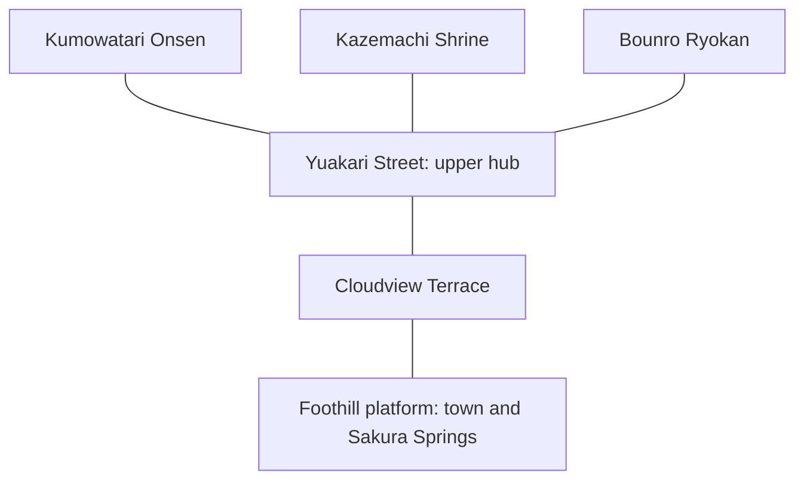
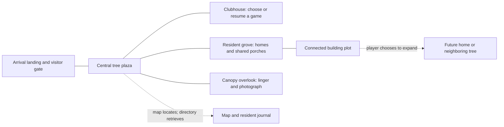
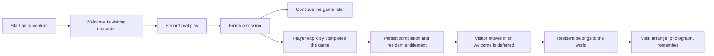

# A place for the games that stay with you

## Yukagecho, Just Play, and the case for a living treehouse world

**Study date:** September 5, 2026

**Reference:** [Yukagecho](https://anime.yukagecho.workers.dev/)

**Just Play baseline:** `b0ecead`

**Status:** original reference study and world-model proposal. The owner
subsequently approved a public demo, with the refinements below. Statements
about the existing app in this study refer to baseline `b0ecead`, not the
later demo implementation. The September 10 revision below supersedes the
earlier proposed lifecycle and construction rules; the reference observations
and historical proposals remain intact. The October 18 focus-first addendum
below connects that accepted world model to the real gaming experience;
[PRODUCT.md](../PRODUCT.md) is the canonical product-direction specification.

**Handoff packaging:** the complete historical study and new focus-first
clarification are retained here as product context, not an instruction to
restart a settlement rebuild. The fictional demo and art prototypes described
below belong to separate source commit `6a4370096092c9225578c3462a06d66b854ab133`;
that source is retained locally, not published or included in this handoff.
Archive paths identify provenance rather than public downloads. Read
[the current work plan](standby-canopy-handoff.md) before assigning any task.

**Art follow-up:** the separate local `docs/canopy-art/README.md` preserves the
September 12 representative Blender slice and its source, specs, and findings.
Archived September 26: technically complete, visual approval pending, no
production integration or approval to expand the full settlement.

**The central idea:** Just Play should not simply display completed games inside
a 3D scene. Playing should leave something behind: a resident, a memory, a home,
and eventually a neighborhood that could only belong to this player.

This document has two jobs. First, describe what Yukagecho actually offers and
why its world feels compelling. Second, translate those lessons into a concrete
but revisable model for Just Play.

Throughout, **observed** means rendered or exercised in the reference,
**source-supported** means supported by its publicly delivered client code,
and **proposed** means a recommendation for Just Play. These are not
interchangeable.

### October 18 clarification: the game stays in the foreground

**Source:** the owner's organic StandBy/Canopy play experience and subsequent
request to document the vision before building more features. This is a
product-direction clarification, not a new implementation or art approval.
It does not revoke the September 10 stamp, permanence, remnant, or contribution
rules.

Just Play's center is not the settlement renderer or the tracker. It is the
person enjoying the game they meant to play. The phone or second monitor can
become a quiet companion instead of a source of competing content. A simple
viewer and a metaphorical Canopy both serve that purpose; the player does not
owe either one interaction.

The repertoire grows **Backlog -> In Progress -> Completed**, brick by brick.
The owner selected both completion pace and net unfinished-backlog change as
optional trends. Starting a queued game does not clear it, and setting one
aside does not count as beating it. The definitions and accounting boundaries
live in [Healthy backlog flow](../PRODUCT.md#healthy-backlog-flow).
Greater enjoyment and follow-through are goals; faster completion and reduced
unwanted phone checking remain outcomes to evaluate, not established benefits.

The world should make that real journey feel continuous. A meaningful game
moment might eventually leave a keepsake, enrich a resident's contribution,
or change a familiar space. Existing arrival stamps can precede game completion:
do not conflate a completed repertoire, a finished session, and permanent
residency. Ambient display and conversation alone never provide proof.

The earlier approved world model still gives a game its own invited avatar
and permanent arrival. A continuing R1 caretaker/host across games is a new
working narrative suggestion, not a replacement for that model or accepted
canon. Its relationship to game-linked residents, home, memory, and dialogue
needs a later decision. The actual real-session nook currently has only a
neutral, Idle-animated R1 in a fixed room; it has no game personification,
earned arrival, dialogue, gameplay awareness, or persistent world memory.
The separate fictional `/demo` must not stand in for account integration.

During play, company should stay ambient. At a natural break, interaction can
be voluntary; afterward, reflection and recognition can be brief and optional.
No resident needs feeding, no reward expires, and ignoring the companion does
not damage the world. Meaning comes from the game, not from farming chats,
minutes with a viewer open, or repeated check-ins.

Shared context must be honest and player-controlled: the app's selected game,
session, goal, and notes are not live knowledge of the other monitor.
Game-related stories or responses would need explicitly shared context or
separately approved, opt-in supported integrations. No silent observation,
invented milestones, or unwanted spoilers.

Eventually the home could express a gaming legacy that friends deliberately
visit or enjoy together: a new couch-co-op feeling, not another infinite feed.
Keep private ownership, voluntary sharing, and attention to the actual game
ahead of messages, public rankings, or social obligations. Persistent memories,
interactions, account-backed world growth, and community remain future work.

One reported episode of not checking a phone is a useful qualitative signal.
It is not measured behavior, a controlled comparison, or proof of treating
addiction. The next product decisions should preserve enjoyment, agency,
healthy stopping, and trustworthy records rather than maximize app engagement.

### The brief we established

The owner wants a broader gaming home, not only a faster recommendation screen:
an avatar exploring a tree-themed plaza, treehouses and bridged spaces, an
expandable settlement, and completed-game NPC residents who live there.
The world should be private first, with optional friend visits.

The meaning of an individual house remains open. The owner's strongest
reference points are movement, spatial exploration, style, art direction, and
resident presence. The last of these is an ambition for Just Play, not a feature
this study found in Yukagecho.

### September 5 decisions after the initial study

The owner confirmed **visitor-to-resident progression**: starting a game brings
a visiting character to the travelers' lodge; completion makes that same
character a permanent neighbor. Backlog adventures have no character yet.
These areas are addresses, not boundaries: visitors and residents can use the
same plaza and paths. Replaying a completed game does not revoke residency.
This lodge-based invitation model was implemented in the first demo and
subsequently superseded by the September 10 decision below.

The owner also established **ambient art mode** as a core experience: hide the
interface and admire the settlement through a still composition or slow camera
tour. Idle display earns no progress and demands no attention.

For the first implementation, the owner chose a **shareable, no-login demo**
with explicitly fictional sample games and local saves rather than real account
integration. The demo uses original characters; licensed game characters,
multiplayer, and native screensaver packaging remain outside its scope.

### September 10 revision: stamps, remnants, and earned contributions

**Source:** the owner's supplied "Treehouse App Specs" and the explicit
follow-up choices recorded in this conversation. The owner chose to adapt the
current presentation demo to this direction, not defer it to a later iteration.
The following is the accepted product mapping, now implemented in the public
local-first `/demo`. It does not describe the separate account-backed app.
The separate prototype's local `docs/demo.md` documents its controls and limits;
that guide and prototype are not needed to run this handoff.

#### The revised think piece

The treehouse is no longer simply a place where completed games retire. It is
a physical autobiography of attention: the worlds someone tried, the journeys
they consider meaningful enough to welcome home, and the adventures that changed
the shape of their space. The player, not a universal completion percentage,
defines the threshold of belonging. A two-hour encounter can be enough to make
an avatar permanent; later reaching the credits can give that same neighbor a
larger contribution. A postcard can honor a journey that stopped without
turning it into a failed quest. The map explains where the world could grow,
earned additions give that growth a cause, and choosing where to place them
makes the result personal. In ambient view, those decisions remain legible
without counters: this plant, that room, and this familiar face are there because
of something the player actually chose to spend time with.

#### Accepted vocabulary and rules

| Term | Accepted meaning |
| --- | --- |
| Backlogged | A game in the library that is not currently invited and has not earned arrival. Its avatar is outside the settlement, not an idle NPC waiting for attention inside it. |
| Invited | The user has started or re-invited the game. Before arrival, its avatar is traveling outside the settlement, represented in the journal and map rather than visiting the lodge. |
| Stamp of proof | The user's chosen "done enough" milestone, configured per game or inherited from a default rule. Examples include hours played, a story milestone, or full completion. |
| Arrived | The chosen stamp has been met. The same avatar becomes a permanent resident; replay, stopping a later replay, and unearned higher tiers do not revoke that belonging. |
| Merit tier | A deeper level of engagement that changes the existing avatar's treatment or contribution. Visited, Resident, and Elder are example tier names, not three successive grants of permanence. |
| Contribution | An original, game-inspired trinket, furnishing, decoration, or structural addition that records the depth of engagement. Later tiers enrich the same game's contribution rather than duplicate its avatar. |
| Remnant | A small keepsake, such as a postcard, left by an invitation that ended before arrival. It persists until the user deletes it or earns the game's arrival after re-inviting it. It is not a debt or penalty. |
| Compatible branch | A valid attachment site for an earned structural addition, including its footprint and navigation connection. The player chooses placement; there are no costs or timers. |

The three-state product cycle stays **Backlogged -> Invited -> Arrived**.
Remnants record attempts alongside that cycle rather than inventing a punitive
fourth status. A replay is activity attached to a game whose permanent arrival
already exists, not a transition that sends its resident away.

The owner resolved the concrete two-hour example: if two hours is the chosen
stamp, the avatar arrives permanently with a small contribution. Reaching the
credits later enriches that same resident's contribution into an earned room,
deck, or similar structural addition. The player then places the addition.

For the public fictional demo, the user explicitly confirms that the configured
milestone has been met. This is labeled as self-confirmation of a sample-game
milestone, not a claim of verified telemetry. Leaving the scene running never
advances hours, stamps, or tiers.

#### Source details retained from the supplied specifications

- Remnants persist indefinitely, can be deleted manually, and are replaced by
  the avatar's full contribution when a re-invited game earns arrival. Merely
  re-inviting a game does not itself erase the attempt.
- Users can define multiple tiers and use default rules or per-game thresholds
  to accommodate short, long, and open-ended games fairly.
- Lower engagement can contribute a figurine, framed icon, or small prop.
  Deeper engagement can earn a room, deck extension, loft, or garden patio.
- The supplied examples contrast a fantasy RPG's small treasure chest with a
  great-hall extension and sword display, and a farming game's potted plant
  with an outdoor garden patio. These illustrate the contribution system;
  they are not promises to copy licensed game art.
- Avatars should have a personable, customizable-character feel. The demo keeps
  its own original character designs rather than reproducing Nintendo assets.

#### Implemented mapping from the first demo

| First demo surface | September 10 adaptation |
| --- | --- |
| Journal: Backlog / Visiting / At home | Explain Backlogged / Invited / Arrived; show invitations traveling outside the settlement and keep permanent residents visible during replay. |
| Start sample game | Invite the avatar and show the selected stamp; do not spawn a lodge visitor. |
| Complete sample game | Self-confirm a configured milestone, granting permanent arrival when it meets the chosen stamp and enriching contributions at later tiers. |
| No stopped-game keepsakes | Allow ending an unarrived invitation, displaying its remnant in the world and journal, manually deleting it, and re-inviting without shame. |
| Freely available Build Fern House | Show earned structural contributions and let the player choose a compatible placement. A bridge, destination, collision surface, and map entry must become available together. |
| Shared resident appearances and houses | Preserve avatar identity while adding game-specific props, structural contributions, and tier treatments to the authored visual world. |
| Guided completion-to-house tour | Demonstrate invitation, a self-defined stamp, permanent arrival, deeper merit, and player-chosen placement using real saved state. Include a dropped-attempt/remnant path. |
| Version-one browser save | Preserve notes and established residents when adapting existing saves; do not silently reset a user's world to demonstrate the new model. |
| Ambient art, photography, furnished interior, public route | Retain these capabilities without awarding progress for viewing or requiring accounts. |

#### Boundaries and deliberately deferred details

The approved demo remains public, local-first, and built from clearly fictional
games and original art. It does not introduce real game launchers, achievement
verification, accounts, multiplayer, licensed characters, an economy, native
screensaver packaging, or unrestricted architecture.

The full production policy for editing already-achieved thresholds and catalog
of contribution shapes remain deferred. The demo retains immutable proof
snapshots and never revokes an arrival, earned depth, or placed addition after a
rule edit. Changed milestones need another explicit confirmation. It supports
one to five configurable tiers, 200 proof snapshots per game, six original
contribution themes, and seven authored branch sites. Additions are open-air,
placed once, and enriched in place; they are not unrestricted construction.
Legacy residents and Fern House are preserved without invented proof records.

The sections below retain the September 5 analysis and proposed mapping for
historical context. Where they describe lodge visitors, fixed completion-based
residency, or freely available construction, this revision takes precedence.

---

## Part I. What it means to arrive somewhere

### 1. The world comes before the menu

Yukagecho opens on a lantern-lit street beneath a floating settlement. There is
already a traveler in the scene. Timber buildings, glowing windows, stone
paving, and rounded trees establish a human scale; islands above the street
establish the larger promise.

The first useful thing the scene tells you is not a feature list. It tells you
that there is somewhere to go.

The red ascent is visible beyond the houses. Architecture frames the route;
light emphasizes the street; the distant settlement supplies a destination
before you have learned its name. The camera is elevated enough to show the
world as a small diorama, but the visible avatar prevents it from becoming only
a model to rotate.

That distinction matters. A dashboard presents information to an observer.
A navigable world gives that observer a position. Once you occupy a position,
distance, arrival, familiarity, and return become available as design tools.

**For Just Play:** a home should be recognizable before its controls are read.
The player should see a familiar tree, a place currently in use, and signs that
past experiences still belong here. This is stronger than putting a tree
illustration behind the existing cards.

### 2. A bridge is a promise, not just a connector

The reference's route can be read as a small journey: foothill town, ascent,
resting terrace, floating main street, then branches to distinct destinations.
This is a narrative reconstruction from inspected locations and the authored
connection graph, not a claim that every segment was walked continuously.

The terrace is particularly instructive. It is neither the beginning nor the
destination. Its small teahouse and tree give the player a reason to understand
the space between them. The next bridge continues upward, while the town
remains conceptually behind and below.

On the upper street, branching bridges change the question from "How do I get
there?" to "Where do I want to go?" The onsen, shrine, and ryokan have different
silhouettes and spatial arrangements. Choice becomes geography.

A link in a navigation bar tells you two pages are related. A bridge shows
their relationship, lets you experience their separation, and makes their
connection part of your memory.

**For Just Play:** infrastructure should explain growth. A new house attached to
a familiar branch is more meaningful than another item appended to a grid.
But repeated travel must remain optional when the player simply wants to resume
a game.

### 3. The interface is a travel companion

The reference keeps its controls at the perimeter: identity and world settings
above, a location caption below left, controls below center, and a circular map
below right. The central space belongs to the world.

Three different questions receive three different answers:

| Player question | Reference answer |
|---|---|
| Where am I? | Location title and directional marker on the minimap |
| What can I do here? | A contextual interaction prompt near a landmark |
| What have I found? | A travel journal with discovered and undiscovered entries |

The journal does not replace the world. It summarizes a relationship the player
has formed with it. A landmark can be near the player without already being
recorded: discovery requires an interaction.

This makes noticing feel like an action without turning it into a demanding
task. The reward is modest: a short place story and a persistent journal mark.

**For Just Play:** the equivalent is not a wall of XP numbers. It is a resident
whose presence leads back to the game, the completion, and the player's own
memories. The map should help find that resident; the journal should explain
why they are here.

### 4. Atmosphere is made from relationships

Calling the reference "cozy" would be accurate but insufficient. Its effect
comes from concrete contrasts.

Dark roofs sit above luminous windows. Warm lanterns punctuate muted paving.
Pink canopies interrupt architectural repetition. Pale mist separates near
platforms from far islands. Large rock forms and soft tree masses sit beside
fine roof ridges, railings, and structural beams.

The result is neither photorealism nor a uniformly simplified toy scene.
Large shapes make the world readable; repeated small details make it feel
constructed. The red bridges stand out because the surrounding world gives
them room to do so.

Its upper islands also work as a horizon. They make the world feel larger than
the set of places the player can actually reach. This is an effective scenic
device, but it introduces a responsibility: visible promise and navigable
reality must not diverge so far that curiosity becomes frustration.

**For Just Play:** trees should be structural, not scattered props. Trunks,
branch junctions, decks, stairs, and bridges should explain why houses are
where they are. The visual center of the experience is a settlement supported
by living trees, not floating buildings with foliage added afterward.

### 5. The camera turns scenery into something personal

The reference provides a follow camera with drag-to-look and scroll-to-zoom,
plus a separate photo action. Hiding the interface leaves the world largely
unframed by product controls. Saving a photo produces a scene-only PNG rather
than a screenshot of the entire web page.

These are different kinds of agency. Moving determines where the traveler is.
Looking determines what matters in the frame. Taking a photo declares that a
particular view was worth keeping.

**For Just Play:** that third act could become especially meaningful after a
resident arrives. A photograph of two residents on a bridge could recall two
games and the period of life in which they were played. This is a proposed
memory feature, not something the reference currently associates with games.

### 6. A place to visit becomes a place to return to

Yukagecho supplies an appealing place to explore. Just Play has the opportunity
to supply a reason that the same place changes over time.

Consider a proposed return: yesterday, a character was visiting while the player
worked through their game. Today, after marking it complete, that familiar
visitor is moving into a permanent home. On a later visit, that resident is
reading on a porch. On another,
they are walking toward the overlook.

Nothing urgent is happening. That is the point. The game no longer needs to
remain an unfinished obligation to remain present in the player's life.

This is the emotional difference between a trophy and a resident. A trophy
states that something happened. A resident gives it a continuing place.

The home must not make that continuity conditional on attendance. Residents
should not become unhappy when the player is away, demand chores, or withhold
affection until another streak is maintained. They are memories made present,
not another backlog.

---

## Part II. What the reference actually does

### 7. A bounded world with seven landmarks

The public world definition contains **six traversable platforms connected by
five bridge links**, with **seven named discovery landmarks**. The foothill
town and Sakura Springs share a platform. A location, a building, and a
platform are therefore already different concepts in this reference.

This is a connectivity diagram, not a scale drawing. In the authored coordinates,
the ascent runs north; the onsen branches east, the shrine northwest, and the
ryokan north of the upper hub. Scenic islands in the background are not
additional destinations in this graph.

| Landmark | Spatial character | Lesson for Just Play |
|---|---|---|
| Foothill Onsen Town | Arrival street framed by buildings; visible ascent ahead | Establish a home and a next destination in one view |
| Sakura Springs | A quieter side destination on the starting platform | A place need not occupy a separate island or house |
| Cloudview Terrace | Small landing between lower and upper worlds | Give transitions identity and breathing room |
| Yuakari Street | Upper hub with several bridge branches | Use a recognizable center to organize choice |
| Kumowatari Onsen | Open pool, rocks, trees, and a view over the edge | Include places for lingering, not only performing tasks |
| Kazemachi Shrine | Compact landmark with a distinct gate and approach | Silhouette can communicate identity before labels |
| Bounro Ryokan | Tall, layered architectural destination | A larger landmark helps orient the surrounding world |

### 8. Interaction inventory and limits

| Surface | Observed or source-supported behavior | What must not be inferred |
|---|---|---|
| Traveler | Keyboard movement changes position; the avatar is visible and animated | No demonstrated multiplayer or autonomous resident population |
| Movement controls | Help advertises WASD/arrows, Shift to run, Space to hop; engine contains these handlers | This study did not benchmark a complete traversal or every collision |
| Look camera | Drag changes orientation; source clamps pitch and zoom distance | Not first-person movement or a free-flying editor camera |
| Camera reset | Branded control invokes a view reset in the client | Resetting the camera is not returning the traveler home |
| Landmark prompt | E opens a place story and records discovery; revisits change the prompt's status | "Visit" does not establish a walkable building interior |
| Minimap | Shows platforms, links, landmark symbols, discovery styling, position and camera-yaw direction | No observed click-to-teleport or resident tracking |
| Travel journal | Lists all seven places from the outset, with discovery state | It is not a fog-of-war map that conceals destination names |
| Persistence | A discovery survived reload in the same browser; the traveler returned to the starting position | No demonstrated cross-device discovery or position synchronization |
| Atmosphere | Dusk/night switch changes lighting; ambient sound control toggles successfully | Not a demonstrated real-time day/night cycle; audio quality was not assessed |
| Photography | Saves a scene-only PNG; H hides the normal HUD | No observed in-app photo album, sharing flow, or composition editor |
| Registration | Optional username and Google sign-in flow available from an arrival notice | This is human account registration, not NPC residency |
| Narrow layout | At 390 x 844, movement arrows appear; HUD condenses and some desktop elements disappear | Not a physical-phone or touch-usability certification |

The discovered-place interaction was exercised at all seven landmarks. Each
opened a textual story rather than an interior scene, shopping interaction,
wish-entry form, or character conversation. Evocative action labels invite an
interpretation of the place; the implemented action is substantially simpler.

The inspected engine constructs a traveler and a fixed environment. No
autonomous NPC life, house construction, resident scheduling, or world-editing
interface was found in that inspected scope. Authenticated features were not
explored, so this is not a claim about every possible account-only capability.

### 9. What to preserve, and what to improve

**Preserve the spatial grammar:** visible destinations, short lists of meaningful
places, connected elevations, a legible traveler, quiet environmental motion,
and an interface that yields the center of the screen.

**Do not copy the setting wholesale:** hot springs, shrine imagery, Japanese
place names, and ryokan architecture belong to this particular world. Just Play
needs its own coherent treehouse construction language, not a reskin of these
landmarks.

**Do not mistake visual richness for interaction depth:** building facades can
suggest rooms that do not exist. If Just Play promises house exploration, a
door needs a consistent meaning: enter an actual space, open a clearly framed
memory view, or be explicitly non-interactive.

**Resolve occlusion deliberately:** in the observed arrival and photo views,
foreground roofs occupy substantial screen area and can obscure the traveler
or street. Trees and elevated decks will make this harder, not easier. Camera
collision, foreground fading, and a reliable recenter action need to be designed
as core behavior.

**Protect legibility:** delicate text over luminous scenery helps the reference
feel atmospheric, but the narrow layout puts captions and controls across a
large part of the traversable view. Just Play's actionable text should use
stable backplates and clear hierarchy rather than rely on the scene behind it.

**Make exploration optional, not irrelevant:** a world that must be crossed
before every session would contradict the name Just Play. The solution is not
to remove movement. It is to support both inhabiting the world and acting
directly when the player has little time.

---

## Part III. Mapping the idea to Just Play

### 10. The product that exists, and the product being imagined

The [README](../README.md) already describes a treehouse inhabited by characters
from completed games and labels the redesign as in progress. That is product
intent. The code at this study's baseline implements a different, earlier
surface: a deck, a current-game/session view, and progress/history.

The [root page](../app/page.tsx) loads user, session, game, history, and stats.
The [client shell](../components/app-shell.tsx) manages those three tabs.
[Domain types](../lib/types.ts), [actions](../app/actions.ts), and
[migrations](../scripts/008_add_game_progress.sql) provide the core tracking
foundation. The [current visual system](../app/globals.css) is a dark,
Discord-inspired interface; a 3D treehouse world would be new design work,
not an already established renderer.

| Product concept | Current evidence | Proposed world expression | New work required |
|---|---|---|---|
| Choose a game | Recommendation deck, preferences, booster packs, search | A discovery table or noticeboard near the clubhouse; direct access remains available | Spatial entry point and interaction layer |
| Backlog | README concept; no queued/backlog state in the inspected `GameProgress` model | A browseable collection of possible next adventures, not a landscape of locked empty houses | Explicit library membership/queue semantics |
| Current game | `GameProgress.status = playing` and current-game UI | A visible active-game station within the home | Spatial presentation of existing state |
| Play session | `LockedIn`, `Playing`, `Paused`, `Finished`; goal and notes | A compact session panel available from anywhere | Integration, not a second timer |
| Memories | Session notes, goals, dates, duration and history | Resident journal, room objects, or memory shelves | Persistent memory presentation and optional attachments |
| Completed game | `GameProgress.status = beaten`, `completed_at` | A resident linked to that completion | Resident identity, entitlement, placement and behavior |
| Abandoned game | Separate `abandoned` status | History remains available without a failed-looking or decaying home | Owner-approved definition of whether this also counts as "done" |
| XP and streaks | Profile/stats and reward UI | Secondary information; not the plaza's organizing principle | Decide whether any expansion uses these, without assuming it |
| Houses and expansion | No corresponding world entities | Buildable homes attached to navigable infrastructure | World graph, plots, construction choices and persistence |
| Friends | No visit system in the inspected app | Optional visits to explicitly shared spaces | Invitations, permissions and a defined presence model |

The critical invariant is **session completion is not game completion**.
Finishing tonight's session must not create a resident every night.
Likewise, walking around the plaza must not be recorded as playing the
external game.

The current shell redirects away from the deck while a game/session is active.
A world should not blindly inherit that as "you cannot explore while a game
is active." Game-selection constraints and world-navigation permissions are
different things.

### 11. What should a house mean?

There are three plausible models. None has been approved yet.

| Model | Strength | Cost |
|---|---|---|
| One house per game | Immediate relationship between the library and the landscape | Large libraries create sprawl; unfinished games can become visual obligations |
| One house per function | Easy mapping from existing tabs to places | Risks turning the village into a dashboard with longer navigation |
| Houses as personal homes and gathering places | Supports residents, customization, varied neighborhoods and social life | Requires an explicit way to find a particular game's memories |

**Recommended hypothesis:** use houses as places, residents as completed-game
identities, and a small number of civic objects as product entry points.

A resident has one primary home but can appear elsewhere. A house can host more
than one resident. The player may organize homes around their own associations,
rather than being forced into genre-based districts. The map and resident
directory preserve findability even when spatial arrangement is expressive.

This separates four things that otherwise get tangled together:

- **Game:** the title and its metadata.
- **Completion:** the player's meaningful event.
- **Resident:** the lasting presence associated with that event.
- **House:** a place in the player's world, not the completion record itself.

Moving a resident must not rewrite play history. Remodeling a house must not
erase a completion. Replaying a game should not duplicate or evict its resident.
These are recommended identity rules, pending confirmation of the house model.

### 12. A concrete candidate plaza

The following is a proposed spatial arrangement, not a copy of the reference
and not a prescribed number of production buildings.

The **central tree** is the orientation anchor. Its trunk and canopy should be
recognizable from each connected neighborhood. The **clubhouse** holds a
quick route to the current game and discovery. The **resident grove** contains
homes, porches, and shared places where resident life is visible.

The **overlook** does not need a productivity function. It provides distance,
views, and a place to appreciate the settlement. The **visitor gate** separates
arriving in someone else's world from managing one's own. The **building plot**
shows where the settlement can grow without filling the whole horizon with
locked-content advertising.

The map and journal are available overlays, not another building the player
must physically reach.

#### Infrastructure is a system, not scenery

| World element | Concrete responsibility |
|---|---|
| Tree and branch anchors | Stable locations and elevations to which platforms attach |
| Platforms | Walkable surfaces, safe arrival points, occupancy and camera-clearance bounds |
| Bridges, ramps and stairs | Connections used by player navigation, resident paths and map rendering |
| Houses | Placed structures with recognizable entrances, resident capacity and interior policy |
| Buildable plots | Valid attachment sites with footprints and connection requirements |
| Shared props | Benches, tables, gardens and railings with usable resident activity positions |
| Wayfinding | Place names, destination markers, paths and map entries tied to the same world data |

Start with authored attachment points rather than unrestricted placement.
When a house is added, its entrance, bridge connection, walkable area, map entry,
and resident access should all become valid together. If placement cannot be
saved or would disconnect a route, it should remain a preview with an explicit
error, not appear successfully built.

Adding a house should not automatically imply a resource economy, real-time
construction wait, or unlock purchase. The method for enabling expansion
remains an open product decision.

### 13. Three cameras, conceptually; one coherent world

Just Play needs to distinguish **player position**, **view control**, and
**photography**, even if they share one underlying renderer.

| Mode | Proposed purpose | Required behavior |
|---|---|---|
| Explore | Follow the avatar through paths, bridges and homes | Drag/orbit and zoom; safe boundaries; recenter; clear interaction target |
| Overview | Understand the settlement and locate a resident or house | Show labels and connections; selecting a destination reveals its route and details |
| Photo | Frame a memory worth keeping | Hide HUD intentionally; capture a chosen view; return without relocating the player |
| Ambient | Admire the world without operating the app | Still composition or slow camera tour; predictable exit; no idle progress |

The reference's minimap and save-photo action are useful starting points, not
evidence that it already implements this complete mode system.

In a multi-level treehouse world, a flat dot is not sufficient. The map should
represent the player's platform/elevation and the route to a destination,
including stairs or bridges. A resident entry should distinguish **home** from
**current location**. A prominent home/recenter command should restore
orientation without silently moving the player.

Proposed direct navigation can offer "go there" or a non-spatial equivalent for
routine tasks. Whether this teleports the avatar, moves only the camera, or
opens details must be explicit. Those are different operations, not alternate
names for the same click.

### 14. Residents who live here

The minimum convincing resident is not an AI chat agent. It is a recognizable
presence with continuity.

**Proposed first behavior model:** a small schedule of idle, walk, use-a-prop,
greet, and return-home behaviors on the same connected paths the player uses.
A porch, bench, or lookout gives the character something legible to do.
Animations and pauses should vary enough that residents do not move as a
synchronized crowd.

Starting an adventure introduces its visiting character. They stay at the lodge
and participate in the same shared life as permanent residents. Completion
changes their residency, not their identity.

Approaching a character offers an optional interaction. Their journal connects
the character to the game, completion date, recorded sessions, and the player's
own notes. Do not invent personal memories, story outcomes, or game dialogue
that the player never supplied.

Resident appearance is still undecided. Possible approaches include original
world-native characters representing each adventure or appropriately licensed
game characters. A metadata image or game title is not a license to reproduce
its character model, voice, or artwork.

#### The proposed completion-to-residency flow

Use existing `beaten` semantics for an initial experiment. Do not silently
reinterpret `Finished` sessions or `abandoned` games as completed games.
Before a production "done" flow, decide what completion means for sandbox games,
ongoing multiplayer games, DLC, and games the player intentionally leaves.

Completion must create a durable, deduplicated entitlement, not depend on an
arrival animation finishing. A failed model download can show a placeholder;
it must not lose the resident. Repeated requests or page reloads must not create
duplicates. Existing `markGameBeaten` is a starting point, not an already
atomic completion-and-residency transaction.

If no home is ready, use a welcoming shared space rather than blocking the
completion reward behind construction. A returning player should encounter
their residents without first clearing notifications or watching every missed
arrival ceremony.

### 15. Data boundaries that make the metaphor reliable

These are conceptual responsibilities, not proposed SQL migrations.

| Entity or record | Owns | Must remain independent of |
|---|---|---|
| Existing game and progress | Game identity, current status, aggregate play information | A character's current pose or house decoration |
| Completion record | Stable evidence of the owner's completed-game milestone | Later replay changing the active progress status |
| Resident | Owner, game/completion link, appearance choice and primary home | Re-rendering, session count, camera position |
| World | Owner, layout version and default arrival | Browser-local discovery state alone |
| House/plot placement | Structure identity, parent anchor, transform and occupancy | A mutable array index used as identity |
| Connection graph | Bridge/stair endpoints and valid traversable connections | Separate handwritten minimap coordinates |
| Memory | Player-authored text and permitted media linked to game/session/resident | Generated guesses about what the player experienced |
| Visit permission | Guest, owner, scope, expiry/revocation and allowed actions | Merely knowing a world URL |
| Local view preferences | Camera, input and visual preferences | Ownership or completion authority |

The current per-user Supabase model can remain the foundation, but it does not
yet supply these world records. Persist meaningful state; do not write every
NPC frame or camera movement to the database. Resident motion can be simulated
while a world is open without promising an always-running server simulation.

For optional friend visits, begin with the concept of a **read-only visit to
selected shared content**. Friends should not inherit access to session notes
or a complete library merely because they can see a plaza. Live co-presence,
chat, collaborative building, and guest contributions are separate decisions.

---

## Part IV. Keeping the world honest

### 16. What success should look like

The world has three legitimate rhythms: a short visit to begin playing, a
longer visit to inhabit and arrange the home, and passive appreciation as ambient
art. None should be treated as the wrong way to use Just Play.

Candidate acceptance criteria for a later prototype:

| Situation | Observable outcome to aim for |
|---|---|
| Returning with an active game | Resume/start controls are available without traversing the settlement |
| First visit with no completions | A finished-looking starter home welcomes the player; absence is not failure |
| Starting a game | Its visiting character arrives at the lodge |
| Completing a game | The same visitor becomes a permanent resident linked to the correct game memory |
| Repeat completion request or replay | The original resident remains; no accidental duplicates |
| Adding a home | Placement, connection, map and resident access stay consistent after reload |
| Looking for someone | A directory can locate both their home and their current platform |
| Opening a dialog | World inputs stop; the actual game's session timer follows its own explicit rules |
| Long absence | No decay, guilt messaging, resident punishment or forced catch-up sequence |
| Ambient display | The interface recedes, camera motion can stop, and no gameplay progress is awarded |
| Motion sensitivity or unavailable WebGL | Reduced-motion behavior and a functional non-3D route preserve core tasks |
| Large collection | All residents remain retrievable even if only nearby residents are rendered |
| Friend visit | Only the owner's deliberately shared content is visible; access can be revoked |

A later performance pass needs named devices and measured budgets. This study
does not establish production frame rates. Prefer progressive world loading,
bounded visible populations, lower-detail distant scenery, and an immediate
non-3D path to important actions over demanding that the entire world load
before the player can do anything.

Movement must support keyboard and touch without trapping focus. Important
actions cannot exist only as tiny canvas targets, hover affordances, sound
cues, or color changes. A resident directory, readable controls, adjustable
camera motion, and an accessible game/history view are parts of the product,
not a less authentic version of it.

### 17. The smallest experiment that would prove the idea

**Initially proposed; subsequently approved as a no-login demo:** one central tree, a clubhouse,
two connected residential places, a usable entrance/interior treatment, one
additional buildable plot, and a few explicitly illustrative residents.

The experiment should show the whole causal chain: a game's completion becomes
a resident; the resident belongs somewhere; the player can find them, encounter
them elsewhere, read a memory, add a connected house, and take a photograph.
The current-game action must remain quick throughout.

That is a more useful experiment than building a vast beautiful forest with
no reliable relationship to play history. It is also more useful than moving
the existing tabs into three identical huts.

Do not begin with a construction economy, generative NPC conversations, a
massive open world, or live multiplayer. None is necessary to learn whether
completed-game residents make a personal world worth returning to.

### 18. Decisions this study deliberately leaves open

| Decision | Working recommendation | Why approval matters |
|---|---|---|
| Meaning of a house | Personal place that can host residents; a few civic spaces for functions | Determines scale, layout and data relationships |
| Meaning of "done" | Begin with explicit game completion; design broader closure separately | Affects who becomes a resident and whether the system feels judgmental |
| Resident identity | Investigate a consistent original art family alongside licensed options | Determines production cost, recognizability and rights |
| Expansion | Authored plots and connected construction; no assumed grind or timer | Determines whether building is expression or an obligation |
| Interiors | Establish a consistent entrance contract in the first experiment | Determines whether "exploring houses" is real or merely suggested |
| Friend visits | Private by default, selective read-only sharing first | Does not settle synchronous versus asynchronous presence |
| Direct travel | Keep routine game actions available without walking | Must balance ease of use with meaningful spatial exploration |
| Growth scale | Keep the home legible as the collection grows | Resident capacity, clustering and rendering need realistic examples |

## Closing thought

The strongest lesson from Yukagecho is not that a website can contain a
beautiful 3D town. It is that a place can organize attention differently from
a page: with distance, invitation, scale, an address, and the possibility of
return.

Just Play's opportunity is to connect that sense of place to something the
player actually did. The treehouse plaza becomes a record without looking like
a report. Bridges connect memories without reducing them to categories.
Residents make completed adventures present without making them unfinished.

**The world should grow because you played, and remain welcoming when you
simply come home.**

---

## Evidence and study boundaries

### Reference sources

- [Live experience](https://anime.yukagecho.workers.dev/): rendered locations,
  controls, journal, registration UI, dusk/night appearance and photography.
- [Public client bundle inspected during this study](https://anime.yukagecho.workers.dev/assets/index-CQRnRbq8.js):
  landmark definitions, connection graph, discovery storage, map, dialogs and
  registration UI. Asset URLs may change on deployment.
- [Public world engine inspected during this study](https://anime.yukagecho.workers.dev/assets/engine-B7jqFhVd.js):
  environment construction, traveler movement, camera, collision bounds,
  atmosphere and photo export. This was read as supporting evidence, not copied
  into Just Play.
- [Just Play product context](../PRODUCT.md): confirmed direction and current
  implementation boundaries from the discovery conversation and repository.

### How the observations were obtained

The study combined the live page's accessibility tree, rendered screenshots,
browser interactions, and inspection of the public client assets.
Keyboard movement and drag-to-look were exercised over a short distance.
Because automated rendering was slow, the seven landmark inspections used
**source-assisted relocation in an isolated browser**; the actual E
interactions and resulting journal updates were then exercised normally.
This supports the location and interaction descriptions, not a claim about
end-to-end walking comfort, traversal time, or production performance.

The journal reached seven discovered locations during the landmark pass.
A separate pass confirmed that a recorded discovery survived a reload in the
same browser while the traveler returned to the starting point. The photo
action produced a PNG without the HUD. The narrow-screen observation used a
390 x 844 browser viewport, not a physical mobile device.

No account was created, username reserved, Google sign-in completed, or content
posted. Ambient sound was toggled, but not evaluated by listening.
No authenticated social experience, NPC population, construction system, or
walkable interior was demonstrated.

The diagrams and Just Play proposals above are original analytical work.
Reference artwork, character assets, and implementation code are not part of
this branch's deliverable.
